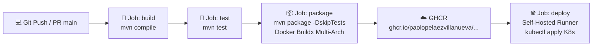

# 🏪 Tambo Backend — Sistema de Gestión Comercial y Punto de Venta (POS)

> **Universidad Tecnológica del Perú (UTP)**  
> **Curso:** Herramientas de Desarrollo (2026)  
> **Docente Auditor:** Ing. Renzo Romero  
> **Entrega:** Segundo Avance de Proyecto Final (APF2)

---

## 👥 Integrantes del Equipo
* **Paolo Peláez Villanueva** (Líder Técnico / Módulo Productos / DevOps)
* **Adrian** (Módulo Ventas y Detalle de Venta)
* **Renato Gutiérrez** (Arquitectura, Base de Datos y Configuración Cloud)
* **Encalada** (Módulo Clientes)

---

## 📌 1. Descripción del Proyecto y Dominio Funcional
**Tambo Backend** es una API REST construida bajo arquitectura en capas con **Spring Boot**, diseñada para administrar el inventario, catálogo, clientes y facturación de ventas en tiendas de conveniencia y abarrotes.

El sistema implementa:
* **Gestión de Clientes:** Padrón de compradores con validación de DNI peruano (8 a 10 dígitos) y control de correos únicos.
* **Control de Inventario y Productos:** Mantenimiento de catálogo, precios en moneda local (PEN), estado activo/inactivo y control de existencias en tiempo real.
* **Procesamiento de Ventas:** Facturación transaccional que valida disponibilidad de stock, descuenta inventario automáticamente, calcula subtotales y total general, y admite ventas con o sin cliente identificado.
* **Control de Acceso y Usuarios:** Registro de operadores y cajeros con asignación de roles (`admin`, `user`).

---

## 🛠️ 2. Stack Tecnológico

| Componente | Tecnología | Detalle |
| :--- | :--- | :--- |
| **Lenguaje** | Java 21 | Eclipse Temurin JDK 21 |
| **Framework** | Spring Boot | Spring Web MVC, Spring Data JPA, Jakarta Validation |
| **Gestor de Proyecto** | Apache Maven | Maven Wrapper (`./mvnw`) |
| **Base de Datos** | MySQL 8.x | Alojado en **Aiven Cloud** con cifrado SSL obligatorio |
| **Contenedores** | Docker | Multi-stage build (Temurin 21 Build + Temurin 21-JRE Runtime) |
| **CI/CD** | GitHub Actions | Compilación, testing, empaquetado y publicación automática |
| **Registry de Imágenes** | GHCR | GitHub Container Registry (`ghcr.io`) con imágenes multi-arquitectura |
| **Orquestación** | Kubernetes (k8s) | Manifiestos de `Deployment` y `Service` tipo NodePort (`30080`) |

---

## 🏗️ 3. Arquitectura del Software
El backend implementa una arquitectura horizontal en capas:

```
src/main/java/com/equipo/tambo/
├── controller/    # Exposición de endpoints REST (HTTP / JSON)
├── dto/           # Data Transfer Objects (Payloads de Request y Response)
├── entity/        # Modelos de dominio persistentes JPA (@Entity)
├── repository/    # Interfaces de acceso a datos (Spring Data JPA)
├── service/       # Lógica de negocio y transacciones (@Transactional)
└── TamboBackendApplication.java # Entry point de la aplicación
```

---

## 🚀 4. Pipeline de Integración y Despliegue Continuo (CI/CD)

El pipeline automatizado en `.github/workflows/docker-image.yml` se dispara ante eventos `push` o `pull_request` sobre la rama `main`:



### Fases del Pipeline:
1. **Build:** Configuración de JDK 21 Temurin y validación sintáctica con `./mvnw compile`.
2. **Test:** Ejecución de suite de pruebas unitarias con `./mvnw test` e inyección segura de `DB_PASSWORD`.
3. **Package & Publish:** Empaquetado del fat JAR, inicialización de emuladores QEMU y Docker Buildx, construcción multi-arquitectura (`linux/amd64`, `linux/arm64`) y publicación en **GitHub Container Registry**.
4. **Deploy:** Despliegue continuo en entorno de ejecución mediante runner local y aplicación de manifiestos Kubernetes (`k8s/deployment.yaml` y `k8s/service.yaml`).

---

## 🐳 5. Guía de Ejecución Local con Docker

### Opción A: Construcción y Ejecución Local desde el Dockerfile
```bash
# 1. Construir la imagen Docker localmente
docker build -t tambo-backend:v1 .

# 2. Ejecutar el contenedor inyectando la contraseña de BD Aiven
docker run -d \
  --name backend-tambo \
  -p 8080:8080 \
  --restart unless-stopped \
  -e DB_PASSWORD="TU_PASSWORD_AIVEN" \
  tambo-backend:v1

# 3. Comprobar estado y ver logs en tiempo real
docker ps
docker logs -f backend-tambo
```

### Opción B: Descargar la Imagen Oficial desde GHCR
```bash
docker pull ghcr.io/paolopelaezvillanueva/herramientas-de-desarrolllo:latest

docker run -d \
  --name backend-tambo \
  -p 8080:8080 \
  -e DB_PASSWORD="TU_PASSWORD_AIVEN" \
  ghcr.io/paolopelaezvillanueva/herramientas-de-desarrolllo:latest
```

---

## 📋 6. Catálogo de Endpoints REST (API Reference)

> **Nota de compatibilidad:** La API escucha tanto en los endpoints base estándar (`/api/...`) como en las rutas versionadas solicitadas en la rúbrica del curso (`/api/v1/...`).

### 6.1. Módulo Clientes (`/api/clients` o `/api/v1/clientes`)

| Método | Endpoint | Descripción | Status |
| :--- | :--- | :--- | :---: |
| `GET` | `/api/clients` | Listar todos los clientes registrados | `200 OK` |
| `GET` | `/api/clients/{id}` | Obtener cliente por su ID | `200 OK` |
| `POST` | `/api/clients` | Registrar un nuevo cliente | `201 Created` |
| `PUT` | `/api/clients/{id}` | Actualizar datos de un cliente | `200 OK` |
| `DELETE` | `/api/clients/{id}` | Eliminar cliente del sistema | `204 No Content` |

**Ejemplo de Petición (POST):**
```json
{
  "name": "Carlos",
  "lastname": "Mendoza",
  "email": "carlos.mendoza@email.com",
  "address": "Av. Los Fresnos 456, Lima",
  "dni": "72889900"
}
```

---

### 6.2. Módulo Productos (`/api/products` o `/api/v1/productos`)

| Método | Endpoint | Descripción | Status |
| :--- | :--- | :--- | :---: |
| `GET` | `/api/products` | Listar catálogo completo de productos | `200 OK` |
| `GET` | `/api/products/{id}` | Obtener producto por ID | `200 OK` |
| `POST` | `/api/products` | Registrar nuevo producto con precio y stock | `201 Created` |
| `PUT` | `/api/products/{id}` | Actualizar atributos y existencias | `200 OK` |
| `DELETE` | `/api/products/{id}` | Eliminar producto | `204 No Content` |

**Ejemplo de Petición (POST):**
```json
{
  "name": "Inca Kola 500ml",
  "description": "Gaseosa personal retornable",
  "cost": 2.50,
  "stock": 50
}
```

---

### 6.3. Módulo Ventas (`/api/sales` o `/api/v1/ventas`)

| Método | Endpoint | Descripción | Status |
| :--- | :--- | :--- | :---: |
| `GET` | `/api/sales` | Listar historial general de ventas | `200 OK` |
| `GET` | `/api/sales/{id}` | Consultar comprobante y detalles por ID de venta | `200 OK` |
| `POST` | `/api/sales` | Emitir venta (valida y descuenta stock automáticamente) | `201 Created` |
| `PUT` | `/api/sales/{id}` | Modificar ítems de la venta y recalcular total | `200 OK` |
| `DELETE` | `/api/sales/{id}` | Anular venta | `204 No Content` |
| `DELETE` | `/api/sales/{id}/details/{detailId}` | Eliminar ítem y reponer stock | `204 No Content` |

**Ejemplo de Emisión de Venta (POST):**
```json
{
  "client": 1,
  "user": 2,
  "details": [
    {
      "product": 1,
      "quantity": 2
    },
    {
      "product": 3,
      "quantity": 1
    }
  ]
}
```
*(Nota: Si la venta es rápida al mostrador sin cliente identificado, `"client": null` es admitido por el sistema)*.

---

### 6.4. Módulo Usuarios (`/api/users`)

| Método | Endpoint | Descripción | Status |
| :--- | :--- | :--- | :---: |
| `GET` | `/api/users` | Listar colaboradores y cajeros | `200 OK` |
| `GET` | `/api/users/{id}` | Obtener información de usuario | `200 OK` |
| `POST` | `/api/users` | Crear credencial con rol asignado | `201 Created` |
| `PUT` | `/api/users/{id}` | Actualizar datos del usuario | `200 OK` |
| `DELETE` | `/api/users/{id}` | Dar de baja usuario | `204 No Content` |

---

## 🛡️ 7. Gobernanza de Código y Flujo Git (GitFlow)

El desarrollo del proyecto se rige bajo las políticas auditables del curso:
* **Protección de `main`:** Prohibido el push directo a producción; todo cambio ingresa mediante **Pull Requests**.
* **Ramas de Vida Corta:** Trabajo aislado en ramas semánticas (`feature/*`, `fix/*`).
* **Commits Atómicos:** Un commit por cambio lógico con mensajes estructurados (`feat:`, `fix:`, `refactor:`, `docs:`).
* **Code Review por Pares:** Aprobación colegiada requerida antes de autorizar cualquier fusión.
* **Trazabilidad en Network Graph:** Registro auditable de colaboraciones en **GitHub Insights → Network**.